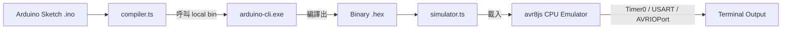

# ATmega328P Arduino Simulator CLI ⚡🤖

基於 **TypeScript / Node.js**、**`arduino-cli`** 與 **`avr8js`** 的 ATmega328P (Arduino Uno) 輕量化模擬器 CLI 工具。

---

## 🌟 特點與亮點

- **零系統依賴 (Zero System Dependency)**：所有相依工具與 `arduino-cli` 二進位檔均自動下載並儲存於專案內部資料夾（`./bin` 與 `./arduino-data`），完全不安裝或修改系統環境變數 (PATH)。
- **自動化後端編譯**：直接傳入 Arduino 原始碼 (`.ino`)，自動呼叫本地 `arduino-cli` 完成編譯並產生二進位機器碼 (`.hex`)。
- **晶片級 CPU 模擬**：使用 `avr8js` 逐指令模擬 ATmega328P 8-bit 微控制器，支援時脈與 Timer0 (正確提供 `millis()`, `micros()`, `delay()` 運作)。
- **硬件周邊監聽 (Peripherals Hook)**：
  - **Serial 輸出**：實時攔截 USART0 暫存器，直接印在終端機。
  - **GPIO 腳位監聽**：掛載 `AVRIOPort` 監聽 Port B 腳位狀態變更（例如：Pin 13 LED 亮/滅 🟢🔴）。

---

## 🏗️ 系統架構與交互邏輯



1. **編譯階段**：`src/compiler.ts` 呼叫獨立於 `./bin/arduino-cli.exe` 的編譯器將 `.ino` 編譯成 `.hex`。
2. **解析階段**：`src/simulator.ts` 使用 `intel-hex` 將 `.hex` 轉為 16-bit 機器碼陣列。
3. **模擬執行階段**：寫入 `avr8js` CPU 程式記憶體，並在 16MHz 時脈迴圈中呼叫 `avrInstruction(cpu)` 與 `cpu.tick()`。
4. **周邊輸出**：掛載 `AVRUSART` (Serial) 與 `AVRIOPort` (GPIO)，即時顯示硬體輸出。

---

## 🚀 快速開始

### 1. 安裝與初始化專案依賴

```bash
# 安裝 npm 模組
npm install

# 自動下載並設定本地 arduino-cli 與 arduino:avr 核心
npm run setup
```

### 2. 編譯 TypeScript

```bash
npm run build
```

### 3. 運行模擬器

使用內建的測試 Sketch (`tests/Blink/Blink.ino`)：

```bash
npm start -- run tests/Blink/Blink.ino
```

**預期終端機輸出**：
```text
--- Step 1: Compiling ---
Using local arduino-cli binary at: .../bin/arduino-cli.exe
Sketch 使用 2052 位元組（6%）的程式儲存空間...

--- Step 2: Simulating ---
Loading HEX file: .../Blink.ino.hex
Starting simulation (Press Ctrl+C to stop)...
   [Hardware] 🔴 Pin 13 (LED) -> LOW
   [Hardware] 🟢 Pin 13 (LED) -> HIGH
Hello from ATmega328P Simulator!
Tick...
   [Hardware] 🔴 Pin 13 (LED) -> LOW
Tock...
   [Hardware] 🟢 Pin 13 (LED) -> HIGH
```

---

## 📂 專案結構

```text
arduino-simulator/
├── bin/                       # 專案獨立執行檔目錄 (存放 arduino-cli.exe)
├── arduino-data/              # 本地獨立 Arduino 工具鏈 (avr-gcc, avrdude 等)
├── arduino-cli.yaml           # 本地 CLI 設定檔
├── src/                       # TypeScript 原始碼
│   ├── index.ts               # CLI 入口檔
│   ├── compiler.ts            # arduino-cli 編譯封裝
│   └── simulator.ts           # avr8js 模擬器與周邊綁定
├── dist/                      # TypeScript 編譯後 JavaScript
├── scripts/
│   └── install-cli.js         # 本地環境自動化安裝腳本
├── tests/
│   └── Blink/
│       └── Blink.ino          # 測試用 Arduino 範例
├── .gitignore                 # Git 忽略設定
├── package.json
├── tsconfig.json
└── README.md
```

---

## 📜 授權

ISC License
